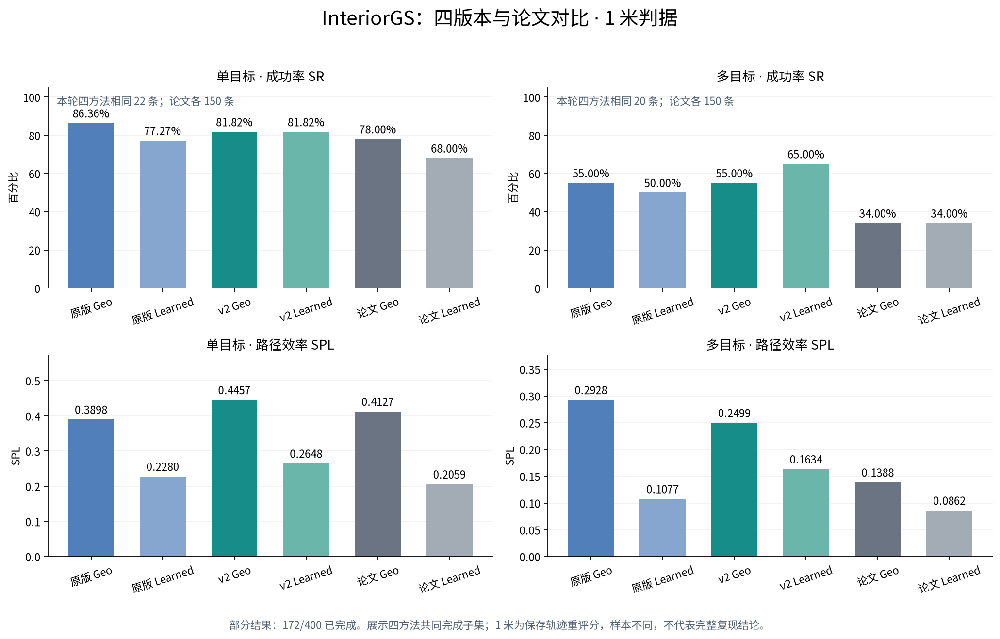

# InteriorGS 仿真评测：部分结果

本轮计划原版 Geo、原版 Learned、v2 Geo、v2 Learned 各执行相同的 50 条单目标和 50 条多目标，共 400 条。实际完成并独立评分 **172 条，剩余 228 条**。2026-10-28 北京时间 09:26，最后一个 worker 在任务间等待 OpenAI 连接超时后退出；没有启动后续 episode。既有退出核验记录显示 8 张 GPU 的原 gpu_stress 已恢复。本次仅离线评分与导出，没有新增模型调用。

Windows 拉取 `results` 分支后，双击根目录的 `打开可视化.cmd`，选择 InteriorGS。也可直接打开 `review/interiorgs/index.html`。支持版本切换、逐步 RGB、VLM 像素选点、实际轨迹、目标距离、顺序目标进度和运行时 Prompt/Skill。

## 与论文同为 1 米判据的比较

下面使用四方法**共同完成的单目标 22 条、多目标 20 条**；另外 4 条已完成结果仍保留在回放和 CSV 中。论文每种方法每类 150 条，因此样本不一致。任务按队列执行，已完成部分不能当作完整随机抽样结果，也不能据此宣称超过论文或确定修改的因果作用。

| 方法 | 单目标 SR | 单目标 SPL | 多目标 SR | 多目标 SPL |
| --- | ---: | ---: | ---: | ---: |
| 原版 Geo | 86.36%（19/22） | 0.3898 | 55.00%（11/20） | 0.2928 |
| 原版 Learned | 77.27%（17/22） | 0.2280 | 50.00%（10/20） | 0.1077 |
| v2 Geo | 81.82%（18/22） | 0.4457 | 55.00%（11/20） | 0.2499 |
| v2 Learned | 81.82%（18/22） | 0.2648 | 65.00%（13/20） | 0.1634 |
| 论文 Geo | 78.00%（117/150） | 0.4127 | 34.00%（51/150） | 0.1388 |
| 论文 Learned | 68.00%（102/150） | 0.2059 | 34.00%（51/150） | 0.0862 |

论文数据与协议来源：[SuperNav Table 1 / Appendix B.2](https://arxiv.org/html/2610.12126v1)。本轮使用实际 GS 场景渲染、GPT-5.6 Terra / high、256×192 Agent 图像；传感器高度 1.25 m。原版 Learned 实际 0.5 / 3，v2 Learned 实际 0.1 / 3；v2 Geo 沿用此次运行冻结的局部提示词修正。每条任务的实际参数、工具白名单与提示词快照可在回放查看。

当前配对样本中，v2 Geo 单目标比原版少成功 1 条，多目标成功数相同；v2 Learned 单目标多成功 1 条，多目标多成功 3 条。样本较小，而且只完成了队列的一部分，保留为阶段性观察。

## 保留公开代码的 0.1 米评分

同一配对样本：

| 方法 | 单目标 SR | 单目标 SPL | 多目标 SR | 多目标 SPL |
| --- | ---: | ---: | ---: | ---: |
| 原版 Geo | 81.82%（18/22） | 0.3669 | 30.00%（6/20） | 0.1667 |
| 原版 Learned | 63.64%（14/22） | 0.1867 | 30.00%（6/20） | 0.0696 |
| v2 Geo | 68.18%（15/22） | 0.3881 | 45.00%（9/20） | 0.2097 |
| v2 Learned | 63.64%（14/22） | 0.2026 | 45.00%（9/20） | 0.1015 |

## 所有已完成记录，1 米评分

此表分母不同，适合查看进度；跨方法比较优先使用上方配对表。

| 方法 | 单目标 SR | 单目标 SPL | 多目标 SR | 多目标 SPL |
| --- | ---: | ---: | ---: | ---: |
| 原版 Geo | 86.36%（19/22） | 0.3898 | 57.14%（12/21） | 0.3009 |
| 原版 Learned | 77.27%（17/22） | 0.2280 | 52.38%（11/21） | 0.1080 |
| v2 Geo | 81.82%（18/22） | 0.4457 | 57.14%（12/21） | 0.2606 |
| v2 Learned | 78.26%（18/23） | 0.2533 | 65.00%（13/20） | 0.1634 |

## 重评分与核验

- 原公开数据文件与评分器没有修改。公开评分器将阈值写死为 0.1 米；另外实现了参数明确的离线评分器，以 1 米重评保存轨迹。
- 单目标：最终位置到全部批准观察点的最短 NavMesh 测地距离严格小于阈值，并且存在显式 STOP。
- 多目标：按照保存轨迹检查顺序到达，要求显式 STOP；起点可以满足目标，同一位置可以满足连续目标，不对保存位置之间插值。
- SPL 使用同一数据集的 global_shortest 参考长度和完整实际路径长度。
- 新评分器在 0.1 米下与公开评分器以及既有结果逐条一致：172/172。另检查阈值边界、缺失 STOP、重叠目标、访问顺序、禁止插值和单目标终点判定。
- 评测地图、批准观察点和距离曲线只用于离线审查，未反馈给导航 Agent。尚未执行的任务不作为失败加入 SR 分母。

数据版本 `yyh929/HabitatGS-Benchmark@4f4f96921dfe4f8e8f720422c5a3d3e5fd70ee57`；选集 seed 42。`verification.json` 保存校验摘要；`episodes.csv` 保存全部 172 条记录在两种阈值下的评分；`comparison.json` 保存配对清单与汇总；`score_and_export.py` 保存评分实现。

## 文件

- [逐任务评分 CSV](episodes.csv)
- [完整汇总与配对清单](comparison.json)
- [校验记录](verification.json)
- 对比图：[SVG](comparison.svg) / [PNG](comparison.png) / [PDF](comparison.pdf)
- 离线入口：`../../review/interiorgs/index.html`

此次回放保留全部 172 条已完成任务、11,088 张去重后的实际 Agent RGB 图像，约 617 MB 图像。未上传场景 PLY/NavMesh、模型权重、认证文件、原始模型 session 或隐藏推理。
